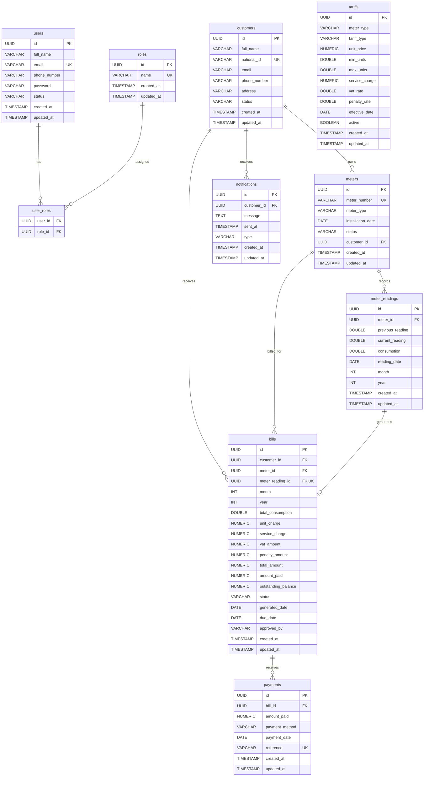

# WASAC Utility Billing System ERD

## Database Overview

The WASAC Utility Billing System uses PostgreSQL to store authenticated users,
utility customers, meters, readings, tariffs, generated bills, payments, and
notifications. All main entity tables use UUID primary keys and include
`created_at` and `updated_at` audit columns inherited from `BaseEntity`.

The actual many-to-many join table defined by the JPA entities is `user_roles`.

## Tables, Keys, and Constraints

### `users`

- Primary key: `id`
- Unique constraint: `email`
- Fields: `full_name`, `email`, `phone_number`, `password`, `status`,
  `created_at`, `updated_at`
- Passwords are stored as BCrypt hashes.

### `roles`

- Primary key: `id`
- Unique constraint: `name`
- Fields: `name`, `created_at`, `updated_at`
- Allowed role names: `ROLE_ADMIN`, `ROLE_OPERATOR`, `ROLE_FINANCE`,
  `ROLE_CUSTOMER`

### `user_roles`

- Foreign key: `user_id` references `users.id`
- Foreign key: `role_id` references `roles.id`
- Join table for the many-to-many relationship between users and roles.

### `customers`

- Primary key: `id`
- Unique constraint: `national_id`
- Fields: `full_name`, `national_id`, `email`, `phone_number`, `address`,
  `status`, `created_at`, `updated_at`

### `meters`

- Primary key: `id`
- Foreign key: `customer_id` references `customers.id`
- Unique constraint: `meter_number`
- Fields: `meter_number`, `meter_type`, `installation_date`, `status`,
  `customer_id`, `created_at`, `updated_at`

### `meter_readings`

- Primary key: `id`
- Foreign key: `meter_id` references `meters.id`
- Unique constraint: (`meter_id`, `month`, `year`)
- Fields: `meter_id`, `previous_reading`, `current_reading`, `consumption`,
  `reading_date`, `month`, `year`, `created_at`, `updated_at`

### `tariffs`

- Primary key: `id`
- Fields: `meter_type`, `tariff_type`, `unit_price`, `min_units`, `max_units`,
  `service_charge`, `vat_rate`, `penalty_rate`, `effective_date`, `active`,
  `created_at`, `updated_at`
- Tariffs are selected by meter type and effective date rather than linked to
  bills by a foreign key.

### `bills`

- Primary key: `id`
- Foreign key: `customer_id` references `customers.id`
- Foreign key: `meter_id` references `meters.id`
- Foreign key and unique constraint: `meter_reading_id` references
  `meter_readings.id`
- Fields: `month`, `year`, `total_consumption`, `unit_charge`,
  `service_charge`, `vat_amount`, `penalty_amount`, `total_amount`,
  `amount_paid`, `outstanding_balance`, `status`, `generated_date`,
  `due_date`, `approved_by`, `created_at`, `updated_at`

### `payments`

- Primary key: `id`
- Foreign key: `bill_id` references `bills.id`
- Unique constraint: `reference`
- Fields: `bill_id`, `amount_paid`, `payment_method`, `payment_date`,
  `reference`, `created_at`, `updated_at`

### `notifications`

- Primary key: `id`
- Foreign key: `customer_id` references `customers.id`
- Fields: `customer_id`, `message`, `sent_at`, `type`, `created_at`,
  `updated_at`
- Bill and payment database triggers create notification rows.

## Relationships

- A user can have many roles, and a role can belong to many users through
  `user_roles`.
- A customer can own many meters.
- A meter can have many meter readings.
- Each meter reading can generate at most one bill.
- A customer can have many bills.
- A meter can have many bills over time.
- A bill can receive many payments.
- A customer can receive many notifications.
- Tariffs apply to meters by matching `meter_type`; there is no tariff foreign
  key on bills because bills store charge snapshots.

## Database Business Rules

- Customer national IDs, meter numbers, user emails, role names, and payment
  references must be unique.
- Only one reading is allowed per meter, month, and year.
- Each reading can generate at most one bill.
- Only active customers and active meters are included in monthly bill
  generation.
- Billing selects the latest active tariff whose `effective_date` is not later
  than the generation date.
- Existing bills retain their calculated charge values when tariffs change.
- The bill-insert trigger creates a `BILL_GENERATED` notification.
- The payment-insert trigger marks fully settled bills as `PAID` and creates a
  `PAYMENT_CONFIRMED` notification.
- The monthly billing procedure catches and logs errors per reading so one
  invalid row does not stop the remaining batch.

## Mermaid ERD

